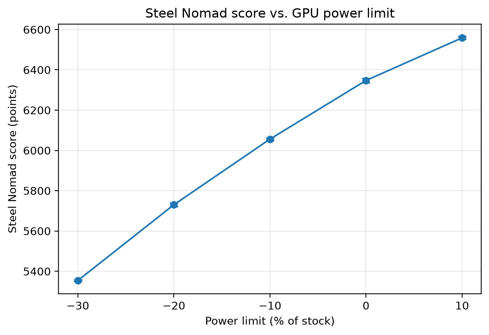
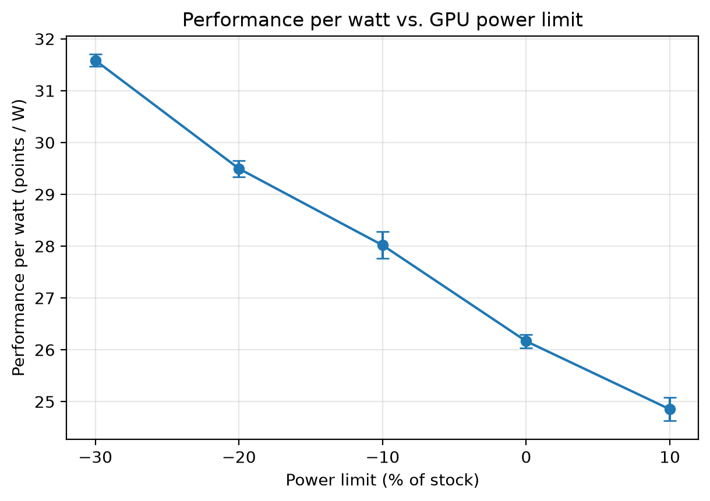
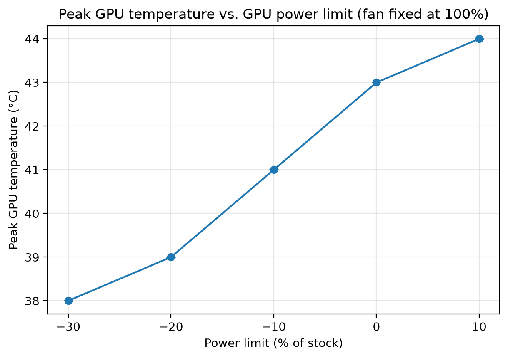

# GPU Power Limit vs. Performance-per-Watt Characterization

## Objective
Measure how the power limit of an AMD Radeon RX 9070 (GIGABYTE GAMING OC) 
affects benchmark score, average board power, peak temperature, and clock 
speed while keeping fan speed constant at 100%. Determine which power limit 
provides the best performance per watt.

**Why this matters.** Embedded and shipboard computers run in sealed,
space-limited enclosures with fixed power budgets and limited cooling, so
engineers care about performance per watt as much as raw speed. This project
tests a desktop GPU, not military hardware, but it uses the same idea:
how much performance is sacrificed as the power limit is lowered, and how much 
power consumption and heat generation are reduced in return.

## Hypothesis (Written on November 3rd, 2026)
I predict performance-per-watt (score ÷ average watts) will be highest at -20% 
because reducing the power limit improves energy efficiency by lowering power 
consumption while letting the GPU maintain most of its clock speed and performance. 
At higher power limits, the GPU uses more electricity for only small performance 
gains. I predict the score at -30% will be approximately 15% below stock, and the 
+10% setting will raise the score by approximately 2%. 

## Methodology
- Hardware/software: RX 9070 (stock board power limit 245 W), Ryzen 7 7700X,
Windows 11, open-air case; Adrenalin (Version: 26.11.2); 3DMark Demo
(Steel Nomad, the benchmark test lasts 60 seconds); HWiNFO64 (Version: 8.54-6090)
- Settings: -30%, -20%, -10%, 0%, +10% power limit (only the Adrenalin power
slider changed between batches); 4 trials each (20 runs) plus 1 discarded
warm-up
- Fan: fixed at 100% for every run (Adrenalin Fan Tuning with a flat 100%
curve and Zero RPM off).
- Order: The five power-limit settings were randomized into the following order:
0%, +10%, -10%, -30%, and -20% (see run_order.txt). All four trials of each
setting were performed consecutively.
of a setting were run back to back
- Start Condition: Before each run, the GPU was allowed to return to its 29°C
idle temperature.
- Constants: fan setting, start temperature, driver,
background apps closed, 3DMark defaults
- Logging: a new HWiNFO64 log for every run, every 500 ms (2 rows per
second). Each log has 365 columns; four columns were used in the analysis,
all from the RX 9070:
 `GPU Temperature [C]` (maximum over the entire log),
`GPU Clock [MHz]`, and `Total Board Power (TBP) [W]` (averages calculated using
only rows where `GPU Utilization [%]` exceeded 90%).
All statistics were computed from the per-sample readings with pandas;
HWiNFO's
own session Min/Max/Avg were not used.
- Analysis: analysis.py (Python, pandas, Matplotlib)
To rerun: create a virtual environment, run `python -m pip install -r
requirements.txt`,
then `python analysis.py`. data/raw/test.csv is an idle recording kept as a
reference for the log format

## Results (Generated and committed on November 21st, 2026)

Error bars are +/-1 standard deviation of 4 trials. Temperatures were
measured with the fan fixed at 100%.

## Limitations
- One GPU, one benchmark (Steel Nomad), one system.
- Only 4 trials per setting, so standard deviations are rough.
- Fan fixed at 100%: temperatures reflect maximum cooling, not the stock fan
curve, and cooler silicon can need slightly less power for the same clocks,
so efficiency under default cooling may differ. Fan speed was verified
through the software settings and audible confirmation, but actual fan
RPM was not recorded in the analysis.
- Open-air case: temperatures do not represent a closed case.
- Ambient temperature not tightly controlled.
- Random order: The randomized order consisted of a single shuffle of the
five setting batches. Tests were performed nearly back-to-back to
minimize environmental drift; however, drift within individual batches
was neither monitored nor corrected.
- The averaging window may include the benchmark startup/shutdown.
- Power is the card's own Total Board Power sensor read by HWiNFO, not an
external meter.

## Conclusion
Differences in mean benchmark scores between power-limit settings were 
larger than the standard deviations observed between trials at each setting.

The results show that lowering the GPU power limit improved performance per 
watt, with the -30% setting achieving the highest efficiency of all five 
configurations. At -30%, the RX 9070 averaged 5,354 points while consuming 
169.51 W, resulting in 31.585 points per watt. Compared to the stock setting, 
this represents a 20.7% improvement in performance per watt and a 30.1% reduction 
in average board power. However, this efficiency came at the cost of a 15.6% 
reduction in benchmark score. Peak temperature also decreased from 43°C at stock 
to 38°C at -30%.

The hypothesis was partially supported. Lowering the power limit did improve energy 
efficiency, but the predicted optimal setting of -20% was incorrect. Instead, -30% 
provided the highest performance per watt, approximately 6.6% higher than -20%. The 
+10% setting increased benchmark performance by only 3.3% compared to stock while 
increasing average power consumption by 8.8%, demonstrating diminishing returns at 
higher power limits.

Overall, these results demonstrate that the most power-efficient GPU configuration 
is not necessarily the one with the highest raw performance. For applications where 
minimizing power consumption is more important than maximizing benchmark scores, a 
heavily reduced power limit can provide substantial efficiency improvements. 
However, the -30% setting also sacrifices a noticeable amount of performance. 
These findings are limited to the tested RX 9070, system, cooling configuration, 
and Steel Nomad benchmark; further testing would be needed to determine whether the 
same behavior occurs under different workloads or cooling conditions.
